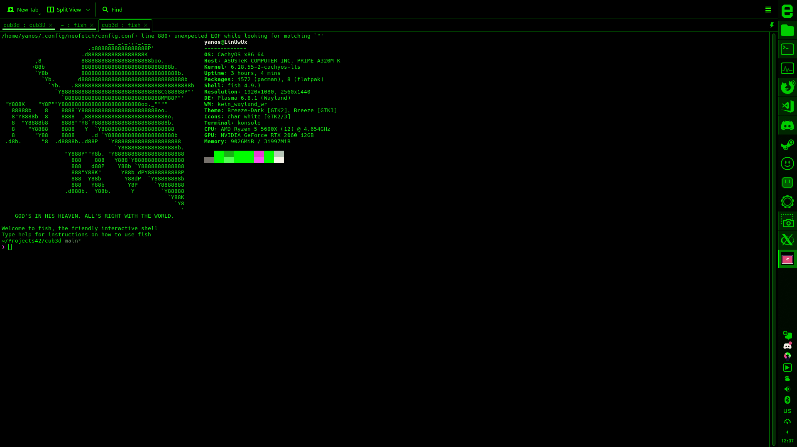

# cub3D

A project from the 42 curriculum. The goal of this project is to create a dynamic 3D representation of a maze using raycasting principles, inspired by the world-famous 1992 game *Wolfenstein 3D*. 



## Overview

This project explores the mathematics behind 3D graphics, specifically raycasting, vector math, and the Digital Differential Analyzer (DDA) algorithm. It relies on the MiniLibX graphic library to render pixels to a window, handle events, and manage textures.

### Key Features

* **Raycasting Engine:** Uses the DDA algorithm for efficient and precise wall collision detection and distance calculation to prevent fish-eye distortion.
* **Texture Mapping:** Dynamically calculates wall textures (North, East, South, West) based on the ray's collision side and the player's position.
* **Floor & Ceiling Casting:** Renders custom RGB colors for the floor and ceiling.
* **MiniMap:** A 2D overlay in the top-left corner tracking the player's position and orientation in real-time.
* **High Resolution:** Renders cleanly at a 1920x1080 window resolution.
* **Event Handling:** Smooth movement and camera rotation using X11 key and window hooks, ensuring a clean exit on window close or `ESC`.

## Compilation and Usage

### 1. Compilation

Clone the repository and compile the project using the provided `Makefile`. The project compiles with `cc` or `gcc` using strict flags (`-Wall -Wextra -Werror`).

```bash
make
```

### 2. Usage

Run the compiled executable by providing a valid `.cub` scene description file as the single argument.

```bash
./cub3D maps/map.cub
```

**Controls:**
* `W`, `A`, `S`, `D`: Move the player (forward, left, backward, right).
* `Left Arrow` / `Right Arrow`: Rotate the camera.
* `ESC` or `[X]` (Window close): Exit the game cleanly.

## Requirements

* **Language:** C
* **Compiler:** `cc` / `gcc`
* **Dependencies:** MiniLibX (requires X11, Xext, and Math libraries: `-lXext -lX11 -lm`)

## Author

* **joschmun** - *42 Student*
